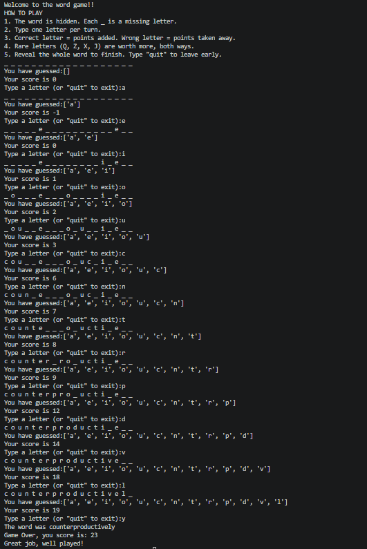

# Letters Game

A word guessing game written in Python. A random long word (over 15 letters) is hidden behind underscores, and you guess one letter at a time to reveal it.

## How it works

- Correct guesses add points and wrong guesses subtract points.
- Each letter has its own value, so rare letters like Q, Z, X and J are worth more (and cost more if you miss).
- The game ends when every letter is revealed, and you get a message based on your final score.
- Type `quit` at any time to stop playing.

## Screenshot

## How to run

1. Download `LettersGame.ipynb` and `safedict_full.txt` into the same folder.
2. Open the notebook in VS Code (with the Jupyter extension) or JupyterLab.
3. Run the cell. In VS Code, the input box for your guesses appears at the top centre of the window.

## What I used

- Python 3 (`random` and `string` modules)
- Loops, functions, lists, dictionaries and `if/elif/else`

## Credits

Word list from [dict4schools](https://github.com/InnovativeInventor/dict4schools).

Created by Deeksha Dhananjaya for Data Engineering for Team Projects at University of Hertfordshire.